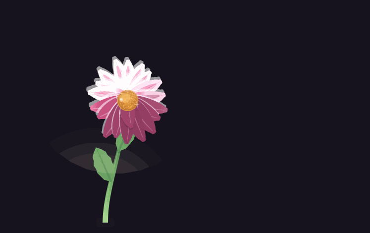
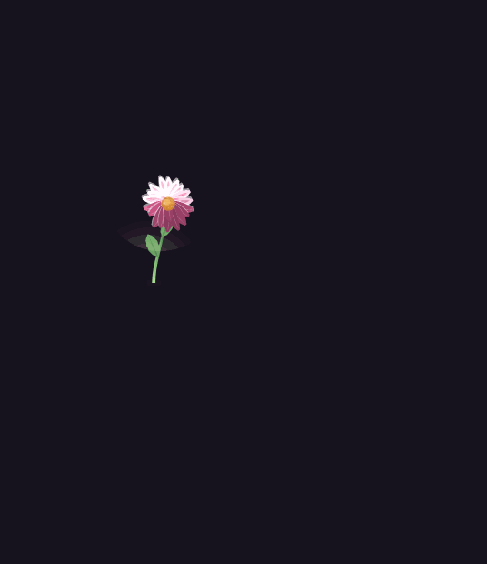
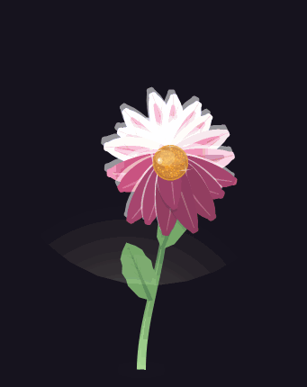

<div align="center">


# Pocket Petal

**A flower you can pick up off your desktop and put on someone's chat.**

One executable. No framework, no runtime, no installer. Drag the bloom onto an AI
chat and it types the note in for you.

**Download:** the standalone `PocketPetal.exe` on the [releases page](../../releases)
— no installer, no runtime, nothing beside it. The filename never carries a version,
so a shortcut you've pinned survives an update; the version is the release's own tag
(`v0.1.0`, and so on). Copy it anywhere and double-click it. **Licence:**
[MIT](LICENSE), so it is yours to fork, change and ship.

The exe is not code-signed, so Windows SmartScreen may say *unknown publisher* the
first time: choose **More info → Run anyway**, and check the download against
`SHA256SUMS.txt` on the release if you like. It makes no network connections of its
own (the coffee button hands a link to your browser), and it writes only its settings
file and, for the chime, a temp copy of a sound. What it does do: when you let it go over a window it clicks there, pastes a note and
presses Enter. Run it with `-dry-run` first, or switch off *Type the note in* on the
panel's Delivery page (which copies the note instead), to see what a drop would do
before it types anything.

[](../../releases)
[](../../actions/workflows/ci.yml)
[](LICENSE)


</div>

---

## Look at it

Picked up, carried off to the right, and let go of while it is still moving — the drag that
delivers a note, at the speed a hand does it:

<p align="center">
  
</p>

The same moment with the camera pulled back to the whole flight. The petals take the
momentum of the drag with them, so a flower flicked to the right comes apart to the right —
and the flower itself stays whole, taking the recoil on its neck:

<p align="center">
  
</p>

Six seconds from a bud to a full bloom, with the sun passing over it as it opens; and the
same flower in each of the four colourways, held and then faded into the next one:

<p align="center">
  
  
</p>

Every picture on this page is drawn by [`cmd/flowergif`](cmd/flowergif) out of the app's own
rig, carry model, burst and rasteriser — the drag filmstrip is the same gesture as
[the storyboard](assets/story-drag.png) — and [`tools/flowergifs.sh`](tools/flowergifs.sh)
makes all of them again in one command. None of it is a mock-up and none of it is a screen
recording: it is what the exe draws, with the camera held still.

---

## What this is

A small always-on-top flower that hangs in the corner of your screen with a soft
sun-glowed bloom, a stalk that is stiff at the base and limp under the flower, and
a head that swings on its neck when you carry it.

Everything it does, it does itself:

| piece | what it is |
| --- | --- |
| **the rig** | the flower as pure mathematics — a spine integrated from a curvature function, petals unfurling on a golden-angle spiral, petals that trail and flutter |
| **the physics** | a bloom that lags behind your hand, a stalk that whips, and a limp neck whose pendulum keeps swinging after you stop |
| **the renderer** | our own scanline rasteriser: polygons, gradients, per-pixel alpha, antialiasing — no canvas, no drawing library |
| **the window** | a layered Win32 window with a premultiplied BGRA bitmap, so the flower is click-through everywhere it is not — sized around the flower so that no drag can clip a petal, standing on the taskbar, with the pointer turning into the pointing finger wherever the flower is |
| **the delivery** | let go over *any* window and the note is pasted into it — a chat the flower recognises, one it has never heard of, a terminal, a browser tab, an IDE panel, an Electron app. Dragging it there by hand is the consent: the flower does not need a name for what it landed on, it only needs you to have put it there. Letting go over the empty desktop or the taskbar is the one place nothing happens, because there is nothing to paste into; a tray click (which nobody aimed) stays cautious and only types into a chat or terminal it recognises outright, copying to the clipboard everywhere else. The note itself is made fresh every time: a compliment built out of word banks and sentence shapes (3.9 million of them, so a lifetime of dragging never repeats), always ending with *"continue where you last left off"* because that is what keeps a long-running assistant going |
| **the burst** | a delivered flower goes off: a flash of its own colour out of the middle of the bloom, and a hundred and thirty-two petals in the same colour flung outwards into a big circle — thrown with spin and a gentle gravity so the area is the effect, and carrying the momentum of the drag that caused it, so a flower flicked to the right explodes to the right. They fly in a surface measured from the flight itself, and a frame draws only the part the petals are in, so the explosion is never cut off by the edge of its own window and a plain drop costs less memory than the square it replaced. The flower itself stays whole |
| **the sun** | a band of warm light sweeps the flower now and then, and again when you pick it up or put it down |
| **the chime** | a small magic twinkle when the flower lands on a chat, drawn at random from the sounds the exe carries *inside* it — in the release exe the MP3s are embedded in the binary and written out to the temp folder only to be played, so there is no sound folder to lose and nothing beside the exe. (The sound files are not part of this repository, so a build from source has none and uses the chime it synthesises in memory; see [`assets/sounds/pack`](assets/sounds/pack/README.txt).) Nothing else in the app makes a noise: a drop anywhere but a chat comes apart in silence. If Windows will not play a file at all, the flower falls back to the same synthesised chime |
| **the tray** | the flower again, at 16 pixels, drawn by the same engine, with the whole of the settings behind a click |
| **the face on the file** | the exe carries the flower on it: the same rasteriser at 16, 24, 32, 48, 64, 128 and 256 pixels, packed byte by byte into an `.ico` and into the resources inside the binary (`cmd/mkicon`, run by the build script), with the version stamp beside it — so Explorer, the taskbar and any shortcut you make show the flower before the app has ever run |

The whole thing builds to a **single 5.6 MB `.exe`** with no dependencies beyond
Windows itself — and it is a *windowed* build (`-H=windowsgui`), so it owns no
console: double-click it and the only thing that appears is the flower, and closing
whatever you launched it from cannot take it down with it.

## Build

Needs Go 1.27 or newer (the version `go.mod` asks for). Nothing else.

```sh
tools/build-release.sh          # checks, then dist/PocketPetal.exe
tools/build-release.sh 1.2.0    # or a version named here, baked in as -version only
```

The script is the whole build, and it is a script rather than a line to copy
because four flags are what make the exe shippable: `-H=windowsgui` (no console
window, ever), `-s -w` (symbols and debug tables stripped), `-trimpath` (no build
machine paths inside) and `CGO_ENABLED=0` (no C runtime to be missing). It checks
the flags came out right — the PE header says *windowed* — and it runs the tests
first, because a release that does not pass its own tests is not a release. Before it
builds, it draws the icon and writes the resources the linker picks up on its own
(`cmd/mkicon`): the `.ico`, and the `.syso` that puts the flower and the version inside
the exe.

Run it, and everything is there: the flower, the settings panel, the tray icon, the
chime, and the flower's own face on the file itself. Copy the one exe anywhere and
double-click it.

For a plain build while working:

```sh
go build -ldflags "-s -w -H=windowsgui" -o PocketPetal.exe .
```

Cross-compile from anywhere:

```sh
GOOS=windows GOARCH=amd64 tools/build-release.sh
```

**The chimes are not in this repository.** The exe on the releases page has its
sounds inside it; the sound files themselves are not published here, so a build from
a fresh checkout has none and plays the small chime it synthesises in memory instead.
Everything else is identical. To bundle your own, drop `.mp3` files into
[`assets/sounds/pack`](assets/sounds/pack/README.txt) and name them in
[`internal/chime/library.go`](internal/chime/library.go) before building. Releases are
built on the maintainer's machine, where the sounds are, with `tools/release.sh`.

Run it, then:

- **drag the flower** with the left mouse button — pick it up by *any* part of it,
  the base of the stem, a leaf's node, the neck or the bloom, and that exact piece
  stays under the cursor while everything around it bends, trails and swings. It
  stands with the bottom of its stem on the top of the taskbar, at every size and
  in every corner, and the pointer turns into the pointing finger over it so you
  can see it is there to be picked up
- **let go** and the flower stays exactly where it was standing: the piece you were
  holding and the base of its stem are reconciled in the same frame, so it never
  leaps up with its feet under the mouse. The bloom then comes apart — a flash and a
  shower of small petals in the flower's own colour, thrown the way you were moving.
  Let go over a chat and it also delivers the note — and *that* is when you hear it: one
  of the app's twinkles, drawn at random, the way the note it carries is made fresh every
  time. Drop it on a terminal, an editor, a page or anything else with a window and the
  bloom still comes apart, in silence: the chime is the sound of a note landing *in a
  chat*, and it is the only noise the app makes. The delivery itself works everywhere you
  drag it: it works out what is underneath, puts the caret where you dropped it, pastes,
  and presses Enter — a known chat, a terminal, a chat box inside a browser tab, an
  Electron app, anything with a window the flower landed on. Only the empty desktop has
  nothing to deliver to, and only a *tray click* (which was never aimed at a particular
  window) stays cautious and copies to the clipboard outside a chat or terminal
- **click the tray icon** (either button, or right-click the flower) for the
  settings. The panel is drawn by the app itself — the same rasteriser, real type
  through a coverage mask — and it is where the flower is *yours*. **Drag the plate
  where there is no row** (the title, a heading, the background between the rows)
  to put the panel wherever you want it, and click the little **✕** in its corner to
  put it away — or press Escape, or click away from it. Everything on the plate
  shows the pointing finger: a row is something to click, the plate's own
  background is something to drag, and one cursor for "there is something here"
  says both without having to be read. The ways out are red — the **✕** that puts the
  panel away, **Back** and **Quit** — and each colourway's name on the Colour page is
  written in the colour it would make the flower, so a row shows its colour instead of
  describing it:

  | page | what it holds |
  | --- | --- |
  | **Colour** | the four colourways, and a wheel that turns any of them into any colour there is — with the stem and leaves turning a fifth as far, so a violet stem cannot happen |
  | **Shape** | stem length, stem thickness, how much it sways, leaf size, how many petals, bloom size, how wide it opens, how much it flutters, how floppy the head is — every one a multiplier of the flower as it ships, dragged live |
  | **Delivery** | type the note or copy it, interrupt a chat that is still answering, press Enter for you, put the caret where the flower landed |
  | **Looks** | the ring around the window it will land on, the sun passing over it, the petal burst on delivery, and a "do it now" for each |
  | **Position** | which corner it stands in — or **a spot of your own**: stand the flower where you want it and choose *Set this spot as home*, and that is where it walks back to. *Forget my spot* puts the corner back in charge |

  At the foot of every page there is one green button that is not a setting — **Buy
  me a Coffee! ☕** — which opens [the coffee page](https://buymeacoffee.com/fazebunssa)
  in your browser and changes nothing in the flower.

  Every choice is remembered in `%APPDATA%\pocket-petal\settings.json`.

  **The flower and the panel are the same share of the desk at every resolution.**
  Both are drawn at the scale of the screen they are on — the flower's box, the panel's
  plate, its rows and its type — measured against a 1080p reference, so a 720p screen
  gets a smaller flower and an 8K one a bigger flower, and the same corner is the same
  distance from the edge at all of them. Change the resolution and the flower is put
  back where it belongs, in the same share of the screen, with an open panel laid out
  again at the new size.
- **`-dry-run`** works out what a drop would do and types nothing; **`-trace`**
  prints where the window is and who owns its pixels; **`-version`** prints the
  settings it is actually running with, and where they were read from; **`-state`**
  writes where the flower is to a file a few times a second, which is how a script
  can check the drag without looking at the screen; **`-log <file>`** appends every
  trace and delivery line to a file even when the app was double-clicked and owns no
  console, which is how a drop that only misbehaves on a cold start gets looked at

Options:

```sh
./PocketPetal.exe -palette buttercup -seed 7 -fps 60 -detail full
```

## Tests

```sh
go test ./...            # the rig, the physics and the rasteriser
go test -bench . ./internal/flower/
```

Two of the promises are about a *running* flower rather than about arithmetic, and
they are checked by driving the real exe with the real mouse:

```sh
powershell -ExecutionPolicy Bypass -File tools/verify-release.ps1 dist/PocketPetal.exe
powershell -ExecutionPolicy Bypass -File tools/drag-check.ps1     dist/PocketPetal.exe
```

The first asks *Windows* to read the icon and the version block back out of the file
(the same calls the shell makes, which is the only way to see that the exe has a face on
it), then copies it into an empty folder, starts it, and reports the windows it owns,
whether it has a console at all, and what it wrote. The second picks the
flower up by the top of its stem, carries it, and reads where its base is before and
after letting go — the bug where a flower released halfway up its stem leapt up
with its feet under the mouse is a comparison of two numbers, and this is them.

## Look at the flower without running the app

The flower is drawn off-screen by the same code the app uses, so a change to the
drawing can be looked at without a window:

```sh
go run ./cmd/flowerlab -mode whole  -out assets/go-whole.png   # five poses side by side
go run ./cmd/flowerlab -mode window -out assets/go-window.png  # what the app shows
go run ./cmd/flowerlab -mode neck   -out assets/go-neck.png    # zoom on the join
go run ./cmd/flowerlab -mode motion -out assets/go-swing.png   # the drag, frame by frame
```

## How it is put together

```
main.go                 flags, DPI awareness, run
internal/flower/        the flower
  types.go              points, fills, shapes, motion, pose
  rig.go                the spine, the head, the bloom, the leaves
  draw.go               the drawing: stem, neck, calyx, petals, sun
  physics.go            the carry model: mass, whip, limp neck, landing
  raster.go             the rasteriser (tiled across cores, bit-identical)
  palette.go            the four colourways and the sunlight
internal/win/           our own Windows layer
  api.go                the Win32 calls, declared rather than imported
  window.go             a layered window with per-pixel alpha
  tray.go               the tray icon and its menu
  screen.go, input.go   work area, DPI, cursor, capture
internal/target/        who else is on the desktop, and what the flower may do there
internal/buddy/         the app itself: loop, drag, tray menu
  sound.go              the one noise it makes: the chime for a drop that lands
internal/icon/          the flower as the file's face: the .ico and the resources
internal/chime/         which sound belongs to which moment
assets/sounds/          the embed for the chimes (the MP3s themselves are not in the repo)
cmd/mkicon/             draws the icon, and writes the resource section for the linker
cmd/flowerlab/          the render lab: the flower to a PNG, without the app
cmd/flowergif/          draws every picture on this page
cmd/look/               what the drag would see at every point on the screen
cmd/probe, cmd/ulwprobe, cmd/boxcheck   small diagnostics for the window and its size
tools/                  the build script, and scripts that drive the real exe
```

The one idea worth keeping in mind: **`PoseOf` is a pure function**. The flower at
time *t*, carried as `motion` says, is a closed-form value — no clocks, no globals,
no windowing. The physics hands it a `Motion`, the renderer hands it pixels, and
the tests hand it nonsense to see that it stays a flower.

## Roadmap

- [x] the flower, in a single executable, draggable
- [x] the physics: weight, whip, limp neck, landing
- [x] the sun: rim light, sheen, sparkle, warm halo
- [x] delivery: drop it on a chat, interrupt the answer mid-stream, type the note
- [x] a highlighter that shows which window the flower will land on
- [x] the settings panel, drawn by the app: colour, shape, delivery, looks, corner
- [x] the burst: a flash and a big circle of the flower's own colour, thrown with the drag
- [x] a settings panel you can drag anywhere, with a cross to put it away
- [x] notes that are made fresh every time, and always end with the same ask
- [x] a chime when the drop lands, drawn at random from sounds embedded in the release exe
- [x] the flower as the file's own face: an icon at every size Windows asks for, and the version beside it
- [x] a green Buy me a Coffee button at the foot of the panel, opening the coffee page
- [x] a home of your own: stand it somewhere and it goes back there
- [x] the same flower, the same share of the desk, from 720p to 8K, with the panel following
- [x] one windowed exe, checked before it is built, for the releases tab
- [ ] Linux (X11) and macOS ports of `internal/win`

## Support

If the flower made you smile, you can buy me a coffee:

[](https://buymeacoffee.com/fazebunssa)

## Licence

MIT. See [LICENSE](LICENSE).
